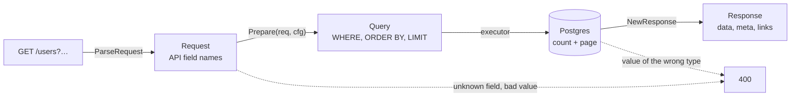

# go-paginate

[](https://github.com/svyatoslavratov/go-paginate/actions/workflows/ci.yml)
[](https://pkg.go.dev/github.com/svyatoslavratov/go-paginate)
[](https://goreportcard.com/report/github.com/svyatoslavratov/go-paginate)
[](https://scorecard.dev/viewer/?uri=github.com/svyatoslavratov/go-paginate)
[](LICENSE)

[Русская версия](README.ru.md)

Pagination, sorting, search and filtering for Go list endpoints, inspired by
[nestjs-paginate](https://github.com/ppetzold/nestjs-paginate). It speaks the same query language:
`page`, `limit`, `sortBy`, `search`, `searchBy`, `filter.<field>=$operator:value` and
`filter=<expression>`, and answers `{data, meta}`, optionally with nestjs-paginate's meta and
`links`. A frontend written for nestjs-paginate can call a Go backend without changes, within the
[differences](docs/nestjs-compatibility.md) listed against nestjs-paginate 16.0.1.

**[Live demo](https://svyatoslavratov.github.io/go-paginate/)**: every filter, sort and answer
format on a real table, in your browser (Go compiled to WebAssembly, Postgres in
[PGlite](https://pglite.dev)). The same demo on chi, GORM and Postgres starts with
`docker compose up` in [examples/catalog](examples/catalog).

- **Two executors, one SQL.** `gormx.Paginate` runs on GORM, `squirrelx.Paginate` runs on squirrel and pgx.
  Both render conditions with the same code, so they behave the same.
- **Filter expressions.** `filter=(status=$in:paid,shipped OR total=$gte:1000) AND NOT comment=$null`,
  with the grammar and the limits of nestjs-paginate 15+.
- **nestjs-paginate answers.** `FormatNestJS` gives `meta.sortBy` as pairs, `meta.filter`
  as strings and links to the neighboring pages.
- **No dependencies in the core.** The root package parses net/http requests, checks them and
  renders SQL conditions; executors for GORM and squirrel + pgx and a fasthttp parser live in their
  own packages, so you compile only what you use.
- **Allowlists.** Clients reach only the fields, columns and operators the config lists. Every
  value is a bind parameter.
- **Stable pages.** A unique tie-breaker column ends every `ORDER BY`, so rows do not jump
  between pages.
- **A GORM builder.** It takes column names from the model and API names from the DTO, so a
  renamed field breaks the build instead of a request.

## Contents

- [Install](#install)
- [Quick start](#quick-start)
- [How a request flows](#how-a-request-flows)
- [Query syntax](#query-syntax)
- [Filters](#filters)
- [Configuration](#configuration)
- [Errors](#errors)
- [nestjs-paginate](#nestjs-paginate)
- [Performance](#performance)
- [Status and versioning](#status-and-versioning)
- [FAQ](#faq)
- [Documentation](#documentation)
- [Contributing](#contributing)
- [License](#license)

## Install

```sh
go get github.com/svyatoslavratov/go-paginate
```

```go
import (
	"github.com/svyatoslavratov/go-paginate"
	"github.com/svyatoslavratov/go-paginate/gormx"     // GORM
	"github.com/svyatoslavratov/go-paginate/squirrelx" // squirrel + pgx
	"github.com/svyatoslavratov/go-paginate/fasthttpx" // fasthttp
)
```

| Package | Import | Use |
|---|---|---|
| `paginate` | `github.com/svyatoslavratov/go-paginate` | Parse (net/http), check and render requests; build answers. No dependencies. |
| `gormx` | `github.com/svyatoslavratov/go-paginate/gormx` | Run requests on GORM; build configs from models. |
| `squirrelx` | `github.com/svyatoslavratov/go-paginate/squirrelx` | Run requests on a squirrel select with pgx. |
| `fasthttpx` | `github.com/svyatoslavratov/go-paginate/fasthttpx` | Parse fasthttp requests. |

Requires Go 1.26 or newer and Postgres (the SQL uses `ILIKE`, `@>` and `CAST`). Another executor
(database/sql, sqlx, bun) can run `paginate.Prepare` the way the bundled ones do.

## Quick start

```go
var usersPage = func() paginate.Config {
	cfg := paginate.NewConfig("users",
		[]string{"users.created_at", "users.name"}, // sortable columns
		map[string]string{                          // API field -> column
			"createdAt": "users.created_at",
			"name":      "users.name",
			"email":     "users.email",
			"status":    "users.status",
		})
	cfg.SearchableColumns = []string{"users.name", "users.email"}
	cfg.FilterableColumns = paginate.FilterableColumns{
		"users.status":     {paginate.OpIn}, // $eq is always allowed
		"users.created_at": {paginate.OpBtw},
	}
	cfg.DefaultSortBy = paginate.SortBy{"users.created_at": paginate.Desc}
	cfg.TieBreakColumn = "users.id"
	return *cfg
}()

func (h *Handler) ListUsers(w http.ResponseWriter, r *http.Request) {
	req, err := paginate.ParseRequest(r)
	if err != nil {
		writeError(w, http.StatusBadRequest, err)
		return
	}
	page, err := gormx.Paginate[User](r.Context(), *req, usersPage, h.db.Model(&User{}))
	if errors.Is(err, paginate.ErrInvalidRequest) {
		writeError(w, http.StatusBadRequest, err)
		return
	}
	if err != nil {
		writeError(w, http.StatusInternalServerError, err)
		return
	}
	writeJSON(w, http.StatusOK, page)
}
```

```http
GET /users?page=2&limit=10&sortBy=name:asc&search=ann&filter.status=$in:active,invited&filter.createdAt=$btw:2024-01-01,2024-12-31
```

```json
{
  "data": [{ "id": 11, "name": "Ann", "email": "ann@example.com", "status": "active" }],
  "meta": {
    "itemsPerPage": 10,
    "totalItems": 11,
    "currentPage": 2,
    "totalPages": 2,
    "sortBy": { "name": "asc" },
    "search": "ann",
    "searchBy": [],
    "filter": { "createdAt": ["$btw:2024-01-01,2024-12-31"], "status": ["$in:active,invited"] },
    "paginationMode": "default"
  }
}
```

With `cfg.Format = paginate.FormatNestJS` the same request answers the
nestjs-paginate way:

```json
{
  "data": [{ "id": 11, "name": "Ann", "email": "ann@example.com", "status": "active" }],
  "meta": {
    "itemsPerPage": 10,
    "totalItems": 11,
    "currentPage": 2,
    "totalPages": 2,
    "sortBy": [["name", "ASC"]],
    "search": "ann",
    "searchBy": ["name", "email"],
    "filter": { "createdAt": "$btw:2024-01-01,2024-12-31", "status": "$in:active,invited" }
  },
  "links": {
    "first": "/users?page=1&limit=10&sortBy=name:ASC&search=ann&filter.createdAt=$btw:2024-01-01,2024-12-31&filter.status=$in:active,invited",
    "previous": "/users?page=1&limit=10&sortBy=name:ASC&search=ann&filter.createdAt=$btw:2024-01-01,2024-12-31&filter.status=$in:active,invited",
    "current": "/users?page=2&limit=10&sortBy=name:ASC&search=ann&filter.createdAt=$btw:2024-01-01,2024-12-31&filter.status=$in:active,invited"
  }
}
```

## How a request flows



1. **Parse.** `paginate.ParseRequest` (net/http), `fasthttpx.ParseRequest` or `paginate.ParseQuery`
   (any router) reads the query string into a `Request`. Only a malformed `sortBy` fails here.
2. **Prepare.** `paginate.Prepare` checks the request against the `Config`: fields and operators
   against the allowlists, sizes against the caps. It maps API fields to columns and renders a
   `Query`: SQL conditions with bind parameters, the `ORDER BY` with the tie-breaker, the page.
3. **Execute.** An executor adds the `Query` to your base query and runs the count and the page.
   `gormx.Paginate` and `squirrelx.Paginate` do steps 2–4 in one call; an executor of your own takes
   a few lines ([example](docs/use-cases/custom-executor.md)).
4. **Answer.** `paginate.NewResponse` builds `{data, meta}` and, with `FormatNestJS`, the links.

A mistake of the client wraps `ErrInvalidRequest` at any step, a value Postgres rejects for its type
included, so one `errors.Is` tells the handler to answer 400.

## Query syntax

| Parameter | Example | Meaning |
|---|---|---|
| `page` | `page=2` | Page number, from 1. |
| `limit` | `limit=50` | Page size, capped by `MaxLimit` (100 by default). `limit=0` asks for the count only, `limit=-1` for every row (where allowed). |
| `sortBy` | `sortBy=pinned:desc&sortBy=name:asc` | Repeated `field:asc\|desc`; the order of the parameters is the priority. |
| `search` | `search=ann` | Case-insensitive substring match over `SearchableColumns`. |
| `searchBy` | `searchBy=email` | Narrows the search to some searchable fields. |
| `filter.<field>` | `filter.age=$gte:18` | A filter; repeat it for several conditions on one field. |
| `filter` | `filter=age=$gte:18 OR status=$eq:vip` | A filter expression: AND, OR, NOT and parentheses over `field=value` terms. |
| `paginationMode` | `paginationMode=count` | `default`, `count` (total only) or `disabled` (every row, only when the config allows it). |
| `withDeleted` | `withDeleted=true` | Soft-deleted rows too (GORM, when the config allows it). |

## Filters

A filter value is `[$or:|$and:][$not:][$operator:]value`.

| Operator | Example | SQL |
|---|---|---|
| `$eq` (default) | `filter.name=Milo` | `name = 'Milo'` |
| `$not` | `filter.name=$not:Milo` | `NOT (name = 'Milo')` |
| `$gt`, `$gte`, `$lt`, `$lte` | `filter.age=$gte:18` | `age >= 18` |
| `$in` | `filter.id=$in:1,2,3` | `id IN (1, 2, 3)` |
| `$btw` | `filter.age=$btw:4,6` | `age >= 4 AND age <= 6` |
| `$null` | `filter.seenAt=$null` | `seen_at IS NULL` |
| `$ilike` | `filter.title=$ilike:red` | `title ILIKE '%red%'` |
| `$sw` | `filter.title=$sw:red` | `title ILIKE 'red%'` |
| `$contains` | `filter.roles=$contains:admin,editor` | `roles @> '{admin,editor}'` (an array column that has every value) |

Several values of one field chain in request order: `filter.id=$gt:3&filter.id=$lt:5&filter.id=$or:$eq:7`
is `(id > 3 AND id < 5 OR id = 7)`. Fields are ANDed, but fields whose first value starts with `$or`
form one OR group. For any other logic use an expression:

```http
GET /cats?filter=(color=$eq:black OR color=$eq:white) AND NOT name=$eq:Leche
```

Values are compared with the column's type: `$eq:10.5` matches `10.50`, and a value that does not
fit the type is a 400. `%` and `_` in `$ilike`, `$sw` and `search` are literal. The details are in
[docs/filters.md](docs/filters.md).

## Configuration

| Field | Default | Meaning |
|---|---|---|
| `TableName` | required | The table; the builder qualifies columns with it. |
| `SortableColumns` | required | Columns clients may sort by; the first one is the last-resort sort. |
| `FieldColumns` | | API field → column for `sortBy`, `searchBy` and `filter`. |
| `DefaultSortBy`, `DefaultSortKeys` | first sortable ASC | The sort of a request without `sortBy`. |
| `TieBreakColumn` | builder: primary key | A unique column appended to every `ORDER BY`. |
| `SearchableColumns`, `MultiWordSearch` | | Columns of `search`; with `MultiWordSearch` every word must match. |
| `FilterableColumns` | | Column → allowed operators; `{}` means `$eq` only, `AllOperators` means everything. |
| `DefaultLimit`, `MaxLimit` | 20, 100 | Page size. |
| `MaxSearchLength`, `MaxFilterConditions`, `MaxFilterValues`, `MaxFilterExpressionComplexity` | 256, 100, 1000, 100 | Request caps. |
| `StrictValidate` | `true` in `NewConfig` | Unknown fields are a 400 instead of being dropped. |
| `AllowDisabledPagination` | `false` | Clients may ask for every row. |
| `AllowWithDeletedInQuery` | `false` | Clients may ask for soft-deleted rows. |
| `CompareAsText` | `false` | Compare `$eq`/`$in` as text, the behavior before typed comparison. |
| `Format` | default | `FormatNestJS` for nestjs-paginate's meta and links. |
| `LinksBaseURL` | relative links | Prefix of the links: an origin or a path. |

Call `config.Validate()` in a unit test: it reports columns no API field reaches, unknown operators
and fields the builder could not resolve. See [docs/configuration.md](docs/configuration.md).

## Errors

- `ErrInvalidRequest` means the client's mistake: unknown field, operator not allowed, malformed
  or oversized value, a value of the wrong type, a malformed expression. Answer 400; the message is
  safe to show.
- `ErrInvalidConfig` means the server's mistake. Answer 500.

## nestjs-paginate

Compared with nestjs-paginate **16.0.1**:

| | nestjs-paginate | go-paginate |
|---|---|---|
| Query parameters, operators, `$not` | ✅ | ✅ |
| `filter=` expressions | ✅ | ✅ |
| `$and`/`$or` inside `filter.<field>` | removed in 15.0 | kept (14.x rules) |
| `limit=0` count only, `limit=-1` every row | ✅ | ✅ (`limit=-1` behind an option) |
| `meta` with the effective sort, `links` | ✅ | ✅ behind `FormatNestJS` |
| Typed comparison, `$contains` as array containment | ✅ | ✅ |
| `multiWordSearch`, `withDeleted`, `ignoreSearchByInQueryParam` | ✅ | ✅ |
| LIKE wildcards in search | wildcards | literal |
| Unknown fields | dropped | 400 with `StrictValidate` |
| `select`, cursor pagination, relations, JSONB paths | ✅ | ❌ |
| Tie-breaker, caps, `Validate`, GORM builder | ❌ | ✅ |

The full [comparison](docs/nestjs-compatibility.md) and a
[migration guide](docs/migrating-from-nestjs.md) with every feature in TypeScript and in Go.

## Performance

The library's work takes microseconds; the database's takes milliseconds. On an Apple M3 Pro,
parsing a typical request (a page, two sort keys, a search and four filters) takes about 1.2 µs and
`Prepare` about 4.6 µs. Against code written by hand for the same request, the library costs the
same with squirrel and about 6 µs more with GORM; end to end on Postgres the two are within noise.
The largest request the default caps admit takes tens of microseconds.
[docs/benchmarks.md](docs/benchmarks.md) has the tables and how to run them.

## Status and versioning

The first release is v0.1.0. Until v1.0.0 a minor release (v0.x.0) may change the API; every change
is in the [changelog](CHANGELOG.md) with upgrade notes, and patch releases (v0.x.y) only fix bugs.
CI runs [gorelease](https://pkg.go.dev/golang.org/x/exp/cmd/gorelease) on every pull request, so an
incompatible change cannot land unnoticed.

| | Versions |
|---|---|
| Go | 1.26 and newer; CI tests the two latest releases |
| Postgres | 13–18, each one in CI |
| GORM | gorm.io/gorm v1.31.2+, gorm.io/driver/postgres v1.6.3+ |
| squirrel, pgx | v1.5.4+, v5.11.0+ |
| fasthttp | v1.75.0+ |
| nestjs-paginate (parity) | 16.0.1 |

## FAQ

**Do I need GORM?** No. The root package has no dependencies; `squirrelx` runs on squirrel and pgx,
and any other executor can call `Prepare` itself ([example](docs/use-cases/custom-executor.md)).

**Is it safe to put user input into SQL like this?** Columns come only from the config, every value
is a bind parameter, `%` and `_` are escaped, and requests are capped in size. Fuzz tests in CI
check that whatever the input, values end up only in the parameters. See
[security](docs/security.md).

**MySQL, SQLite?** Not yet: the SQL is written for Postgres (`ILIKE`, `@>`, `NULLS LAST`, casts).

**How do I answer with DTOs instead of models?** Map the rows and keep the meta: it carries the
format and the links.

```go
page, err := gormx.Paginate[User](ctx, *req, cfg, db.Model(&User{}))
if err != nil {
	return err
}
writeJSON(w, http.StatusOK, paginate.Response[UserDTO]{Data: toDTOs(page.Data), Meta: page.Meta})
```

**Why is an unknown field a 400?** `NewConfig` sets `StrictValidate`, so a typo in a frontend shows
up at once instead of returning unfiltered rows. Set it to `false` for nestjs-paginate's behavior.

**Cursor (keyset) pagination?** Not supported. Offset pagination with a unique tie-breaker gives
stable pages; on deep pages of large tables keyset pagination is faster.

**How do I move an endpoint from nestjs-paginate?** The
[migration guide](docs/migrating-from-nestjs.md) shows every feature in TypeScript and in Go.

## Documentation

- [Query syntax](docs/query-syntax.md), [filters](docs/filters.md), [sorting and tie-breaker](docs/sorting.md)
- [Configuration](docs/configuration.md), [security](docs/security.md)
- [Comparison with nestjs-paginate](docs/nestjs-compatibility.md), [migrating from nestjs-paginate](docs/migrating-from-nestjs.md)
- [Benchmarks](docs/benchmarks.md), [the demo app](examples/catalog)
- Use cases: [net/http + GORM](docs/use-cases/chi-gorm.md), [GORM builder](docs/use-cases/gorm-builder.md),
  [squirrel + pgx and fasthttp](docs/use-cases/squirrel-pgx.md), [joins, aliases, GROUP BY](docs/use-cases/joins-and-aliases.md),
  [exports and counts](docs/use-cases/exports-and-counts.md), [gRPC and other transports](docs/use-cases/grpc.md),
  [OpenAPI](docs/use-cases/openapi.md), [a custom executor](docs/use-cases/custom-executor.md), [testing a config](docs/use-cases/testing.md)
- [Changelog](CHANGELOG.md)

## Contributing

Issues and pull requests are welcome; see [CONTRIBUTING.md](CONTRIBUTING.md). Tests run with
`make test`, and against a disposable Postgres with `make test-pg`; `make bench` and `make fuzz` run
the benchmarks and the fuzz tests, `make demo-up` the demo. Report vulnerabilities privately, as
[SECURITY.md](SECURITY.md) describes.

## License

[MIT](LICENSE).
