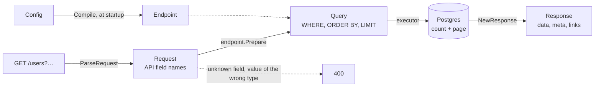

# go-paginate

[](https://github.com/svyatoslavratov/go-paginate/actions/workflows/ci.yml)
[](https://pkg.go.dev/github.com/svyatoslavratov/go-paginate)
[](https://codecov.io/gh/svyatoslavratov/go-paginate)
[](https://scorecard.dev/viewer/?uri=github.com/svyatoslavratov/go-paginate)
[](LICENSE)

[Русская версия](README.ru.md)

Pagination, sorting, search and filtering for Go list endpoints, inspired by
[nestjs-paginate](https://github.com/ppetzold/nestjs-paginate). It speaks the same query language:
`page`, `limit`, `sortBy`, `search`, `searchBy`, `filter.<field>=$operator:value`,
`filter=<expression>` and `cursor`, and answers `{data, meta}`, optionally with nestjs-paginate's
meta and `links`. A frontend written for nestjs-paginate can call a Go backend without changes,
within the [differences](docs/nestjs-compatibility.md) listed against nestjs-paginate 16.0.1.

**[Live demo](https://svyatoslavratov.github.io/go-paginate/)**: every filter, sort, count and
answer format on a real table, in your browser (Go compiled to WebAssembly, Postgres in
[PGlite](https://pglite.dev)). The same demo on chi, GORM and Postgres starts with
`docker compose up` in [examples/catalog](examples/catalog).

- **A field in one place.** Each API field is one `Field`: its column, its type and what clients
  may do with it. Or read the fields from struct tags: `paginate:"sort;search;filter:$in"`.
- **Checked once, at startup.** `Compile` reports every mistake of a config before the first
  request; a request only does what it needs.
- **Typed values.** Fields of type `Int`, `Time`, `UUID`, `Enum(...)` reject a value that does
  not fit before the query runs, with a 400 that names the field.
- **Page numbers or cursors.** Offset pagination with stable pages, or keyset pagination, where
  Postgres starts an index scan right at the cursor however deep the page.
- **Counts that fit the table.** Exact, the planner's estimate, or none at all; alongside the page
  if you like.
- **Errors clients can act on.** `{"code": "invalid_value", "field": "price", "message": ...}`, and
  `HTTPStatus` picks the status.
- **Filter expressions.** `filter=(status=$in:paid,shipped OR total=$gte:1000) AND NOT comment=$null`,
  with the grammar and the limits of nestjs-paginate 15+.
- **Two executors, one SQL.** `gormx.Paginate` runs on GORM, `squirrelx.Paginate` on squirrel and
  pgx; another executor takes a few lines. The core has no dependencies.
- **Allowlists.** Clients reach only the fields and operators the config lists. Every value is a
  bind parameter.

## Contents

- [Install](#install)
- [Quick start](#quick-start)
- [How a request flows](#how-a-request-flows)
- [Query syntax](#query-syntax)
- [Filters](#filters)
- [Configuration](#configuration)
- [Pages and counts](#pages-and-counts)
- [Errors](#errors)
- [nestjs-paginate](#nestjs-paginate)
- [Performance](#performance)
- [Status and versioning](#status-and-versioning)
- [FAQ](#faq)
- [Documentation](#documentation)
- [Contributing](#contributing)
- [License](#license)

## Install

```sh
go get github.com/svyatoslavratov/go-paginate
```

```go
import (
	"github.com/svyatoslavratov/go-paginate"
	"github.com/svyatoslavratov/go-paginate/gormx"     // GORM
	"github.com/svyatoslavratov/go-paginate/squirrelx" // squirrel + pgx
	"github.com/svyatoslavratov/go-paginate/fasthttpx" // fasthttp
)
```

| Package | Import | Use |
|---|---|---|
| `paginate` | `github.com/svyatoslavratov/go-paginate` | Configs and tags, parsing (net/http), checks and SQL, answers. No dependencies. |
| `gormx` | `github.com/svyatoslavratov/go-paginate/gormx` | Run requests on GORM; configs from GORM models. |
| `squirrelx` | `github.com/svyatoslavratov/go-paginate/squirrelx` | Run requests on a squirrel select with pgx. |
| `fasthttpx` | `github.com/svyatoslavratov/go-paginate/fasthttpx` | Parse fasthttp requests. |

Requires Go 1.26 or newer and Postgres (the SQL uses `ILIKE`, `@>` and `CAST`). Another executor
(database/sql, sqlx, bun) runs a prepared query the way the bundled ones do.

## Quick start

```go
// usersEndpoint is compiled once: a broken config stops the service at startup.
var usersEndpoint = paginate.MustCompile(paginate.Config{
	Fields: []paginate.Field{
		{Name: "id", Column: "users.id", Type: paginate.Int},
		{Name: "createdAt", Column: "users.created_at", Type: paginate.Time, Sortable: true,
			Filter: []paginate.Operator{paginate.OpBtw}},
		{Name: "name", Column: "users.name", Sortable: true, Searchable: true},
		{Name: "email", Column: "users.email", Searchable: true},
		{Name: "status", Column: "users.status", Type: paginate.Enum("active", "invited", "blocked"),
			Filter: []paginate.Operator{paginate.OpIn}}, // $eq is always allowed
	},
	DefaultSort: []paginate.Sort{{Field: "createdAt", Order: paginate.Desc}},
	TieBreak:    "users.id",
})

func (h *Handler) ListUsers(w http.ResponseWriter, r *http.Request) {
	req, err := paginate.ParseRequest(r)
	if err != nil {
		writeError(w, err)
		return
	}
	page, err := gormx.Paginate[User](r.Context(), *req, usersEndpoint, h.db.Model(&User{}))
	if err != nil {
		writeError(w, err)
		return
	}
	writeJSON(w, http.StatusOK, page)
}

// writeError answers a client's mistake with a 400 and {code, field, message}, anything else with
// a bare 500.
func writeError(w http.ResponseWriter, err error) {
	if status := paginate.HTTPStatus(err); status == http.StatusBadRequest {
		writeJSON(w, status, err)
		return
	}
	writeJSON(w, http.StatusInternalServerError, map[string]string{"message": "internal error"})
}
```

```http
GET /users?page=2&limit=10&sortBy=name:asc&search=ann&filter.status=$in:active,invited&filter.createdAt=$btw:2024-01-01,2024-12-31
```

```json
{
  "data": [{ "id": 11, "name": "Ann", "email": "ann@example.com", "status": "active" }],
  "meta": {
    "itemsPerPage": 10,
    "totalItems": 11,
    "totalPages": 2,
    "currentPage": 2,
    "hasNextPage": false,
    "hasPreviousPage": true,
    "sortBy": [["name", "ASC"]],
    "search": "ann",
    "searchBy": [],
    "filter": { "createdAt": ["$btw:2024-01-01,2024-12-31"], "status": ["$in:active,invited"] },
    "paginationMode": "default"
  }
}
```

With `Format: paginate.FormatNestJS` the same request answers the nestjs-paginate way:

```json
{
  "data": [{ "id": 11, "name": "Ann", "email": "ann@example.com", "status": "active" }],
  "meta": {
    "itemsPerPage": 10,
    "totalItems": 11,
    "currentPage": 2,
    "totalPages": 2,
    "sortBy": [["name", "ASC"]],
    "search": "ann",
    "searchBy": ["name", "email"],
    "filter": { "createdAt": "$btw:2024-01-01,2024-12-31", "status": "$in:active,invited" }
  },
  "links": {
    "first": "/users?page=1&limit=10&sortBy=name:ASC&search=ann&filter.createdAt=$btw:2024-01-01,2024-12-31&filter.status=$in:active,invited",
    "previous": "/users?page=1&limit=10&sortBy=name:ASC&search=ann&filter.createdAt=$btw:2024-01-01,2024-12-31&filter.status=$in:active,invited",
    "current": "/users?page=2&limit=10&sortBy=name:ASC&search=ann&filter.createdAt=$btw:2024-01-01,2024-12-31&filter.status=$in:active,invited"
  }
}
```

And `filter.status=$in:active,deleted` is a 400 before any query runs:

```json
{ "code": "invalid_value", "field": "status", "message": "invalid value \"deleted\" for status: must be one of active, invited, blocked" }
```

The fields can come from tags instead, written the way gorm tags are:

```go
type User struct {
	ID        int64     `json:"id" paginate:"unique"`
	CreatedAt time.Time `json:"createdAt" paginate:"sort;filter:$btw"`
	Name      string    `json:"name" paginate:"sort;search"`
	Email     string    `json:"email" paginate:"search"`
	Status    string    `json:"status" paginate:"filter:$in;enum:active,invited,blocked"`
}

cfg, err := gormx.ConfigOf[User](db, "") // columns from the GORM schema; paginate.ConfigOf without GORM
```

`ConfigOf` returns a plain `Config`, so tags and code mix: `cfg.Field("status")` changes a field the
tags gave, `append(cfg.Fields, …)` adds joined columns. See
[tags, pointers or code](docs/configuration.md#tags-pointers-or-code).

## How a request flows



1. **Compile, once.** `paginate.Compile` (or `MustCompile`) checks the `Config` and builds an
   `Endpoint`, safe for concurrent requests.
2. **Parse.** `paginate.ParseRequest` (net/http), `fasthttpx.ParseRequest` or `paginate.ParseQuery`
   (any router) reads the query string into a `Request`. Only a malformed `sortBy` fails here.
3. **Prepare.** `endpoint.Prepare` checks the request: fields and operators against the
   allowlists, values against the types, sizes against the caps. It maps API fields to columns and
   renders a `Query`: SQL conditions with bind parameters, the `ORDER BY` with the tie-breaker, the
   page or the cursor, and how to count.
4. **Execute.** An executor adds the `Query` to your base query and runs the count and the page.
   `gormx.Paginate` and `squirrelx.Paginate` do steps 3–5 in one call; an executor of your own takes
   a few lines ([example](docs/use-cases/custom-executor.md)).
5. **Answer.** `paginate.NewResponse` builds `{data, meta}`, the cursors and, with `FormatNestJS`,
   the links.

A mistake of the client wraps `ErrInvalidRequest` at any step, a value Postgres rejects for its type
included, so `paginate.HTTPStatus` tells the handler to answer 400.

## Query syntax

| Parameter | Example | Meaning |
|---|---|---|
| `page` | `page=2` | Page number, from 1. |
| `limit` | `limit=50` | Page size, capped by `MaxLimit` (100 by default). `limit=0` asks for the count only, `limit=-1` for every row (where allowed). |
| `sortBy` | `sortBy=pinned:desc&sortBy=name:asc` | Repeated `field:asc\|desc`; the order of the parameters is the priority. |
| `search` | `search=ann` | Case-insensitive substring match over the searchable fields. |
| `searchBy` | `searchBy=email` | Narrows the search to some searchable fields. |
| `filter.<field>` | `filter.age=$gte:18` | A filter; repeat it for several conditions on one field. |
| `filter` | `filter=age=$gte:18 OR status=$eq:vip` | A filter expression: AND, OR, NOT and parentheses over `field=value` terms. |
| `cursor` | `cursor=WyJuIiwi…` | The page after (or before) a row, in cursor pagination; from the links or the meta. |
| `paginationMode` | `paginationMode=count` | `default`, `count` (total only) or `disabled` (every row, only when the config allows it). |
| `withDeleted` | `withDeleted=true` | Soft-deleted rows too (GORM, when the config allows it). |

## Filters

A filter value is `[$or:|$and:][$not:][$operator:]value`.

| Operator | Example | SQL |
|---|---|---|
| `$eq` (default) | `filter.name=Milo` | `name = 'Milo'` |
| `$not` | `filter.name=$not:Milo` | `NOT (name = 'Milo')` |
| `$gt`, `$gte`, `$lt`, `$lte` | `filter.age=$gte:18` | `age >= 18` |
| `$in` | `filter.id=$in:1,2,3` | `id IN (1, 2, 3)` |
| `$btw` | `filter.age=$btw:4,6` | `age >= 4 AND age <= 6` |
| `$null` | `filter.seenAt=$null` | `seen_at IS NULL` |
| `$ilike` | `filter.title=$ilike:red` | `title ILIKE '%red%'` |
| `$sw` | `filter.title=$sw:red` | `title ILIKE 'red%'` |
| `$contains` | `filter.roles=$contains:admin,editor` | `roles @> '{admin,editor}'` (an array column that has every value) |

Several values of one field chain in request order: `filter.id=$gt:3&filter.id=$lt:5&filter.id=$or:$eq:7`
is `(id > 3 AND id < 5 OR id = 7)`. Fields are ANDed, but fields whose first value starts with `$or`
form one OR group. For any other logic use an expression:

```http
GET /cats?filter=(color=$eq:black OR color=$eq:white) AND NOT name=$eq:Leche
```

A field's `Type` checks every value before the query: `$gte:old` on an `Int` field is a 400 that
names the field. Values are compared with the column's own type, so `$eq:10.5` matches `10.50`.
`%` and `_` in `$ilike`, `$sw` and `search` are literal. The details are in
[docs/filters.md](docs/filters.md).

## Configuration

| Setting | Default | Meaning |
|---|---|---|
| `Fields` | | The API fields: `Name`, `Column`, `Type`, `Sortable`, `Searchable`, `Filter` (allowed operators; `nil`: not filterable). |
| `DefaultSort` | first sortable field ASC | The sort of a request without `sortBy`, in API names. |
| `TieBreak` | | A unique column appended to every `ORDER BY`; cursor pagination requires it. |
| `NullSort` | database default | `NullsFirst` or `NullsLast` for every key. |
| `Pagination` | `OffsetPagination` | Page numbers, or `CursorPagination`. |
| `Count`, `ExactCountBelow`, `ParallelCount` | `CountExact` | How totals are counted: exactly, estimated, or not at all; see [pages and counts](#pages-and-counts). |
| `MultiWordSearch` | `false` | Every word of the search term must match. |
| `Lenient` | `false` | Drop unknown fields and operators that are not allowed instead of answering 400, as nestjs-paginate does. |
| `DefaultLimit`, `MaxLimit` | 20, 100 | Page size. |
| `MaxSearchLength`, `MaxFilterConditions`, `MaxFilterValues`, `MaxFilterExpressionComplexity` | 256, 100, 1000, 100 | Request caps. |
| `AllowDisabledPagination` | `false` | Clients may ask for every row. |
| `AllowWithDeletedInQuery` | `false` | Clients may ask for soft-deleted rows. |
| `CompareAsText` | `false` | Compare `$eq`/`$in` as text, the behavior before typed comparison. |
| `Format` | default | `FormatNestJS` for nestjs-paginate's meta and links. |
| `LinksBaseURL` | relative links | Prefix of the links: an origin or a path. |

Types are `Text`, `Int`, `Number`, `Bool`, `Time`, `Date`, `UUID`, `Enum("a", "b")` and
`ArrayOf(t)`. The fields can be written by hand, read from `paginate` tags (`paginate.ConfigOf`,
`gormx.ConfigOf`), or built from pointers to model and DTO fields (`gormx.NewBuilder`). See
[docs/configuration.md](docs/configuration.md).

## Pages and counts

Page numbers (`?page=3`) read and skip the rows before the page; cursors (`?cursor=`) start right
after the last row the client saw, so a deep page costs what the first one does (404 ms against
0.4 ms at a depth of 855 000 rows) and rows that appear meanwhile do not shift the pages. Cursor
pagination is keyset pagination with the same links as nestjs-paginate's:

```go
cfg.Pagination = paginate.CursorPagination // needs TieBreak; mark the sort fields NotNull where they are
```

```sql
WHERE ((users.created_at <= $1) AND ((users.created_at < $2) OR ((users.created_at = $3) AND (users.id > $4))))
ORDER BY users.created_at DESC, users.id ASC LIMIT 21
```

Totals of page numbers cost a `COUNT(*)`. `Count` chooses: `CountExact`, `CountEstimate` (the
planner's estimate from `EXPLAIN`, exact below `ExactCountBelow`) or `CountNone` (a "next page"
flag from one extra row). `ParallelCount` runs the count alongside the page. See
[docs/pagination.md](docs/pagination.md).

## Errors

- `ErrInvalidRequest` is the client's mistake. The error is a `*paginate.Error` with a `Code`
  (`unknown_field`, `operator_not_allowed`, `invalid_value`, `invalid_cursor`, …), the `Field` it
  is about and a `Message` safe to show; its JSON is the body of the 400.
- `ErrInvalidConfig` is the server's mistake; `Compile` reports it at startup.

`paginate.HTTPStatus(err)` is 400 or 500. See [docs/errors.md](docs/errors.md).

## nestjs-paginate

Compared with nestjs-paginate **16.0.1**:

| | nestjs-paginate | go-paginate |
|---|---|---|
| Query parameters, operators, `$not` | ✅ | ✅ |
| `filter=` expressions | ✅ | ✅ |
| `$and`/`$or` inside `filter.<field>` | removed in 15.0 | kept (14.x rules) |
| `limit=0` count only, `limit=-1` every row | ✅ | ✅ (`limit=-1` behind an option) |
| `meta` with the effective sort, `links` | ✅ | ✅ behind `FormatNestJS` |
| Cursor pagination | numbers and dates, computed in SQL | keyset on any type, an index range with `NotNull` keys |
| Typed comparison, `$contains` as array containment | ✅ | ✅ |
| `multiWordSearch`, `withDeleted`, `ignoreSearchByInQueryParam` | ✅ | ✅ |
| LIKE wildcards in search | wildcards | literal |
| Unknown fields | dropped | 400, or dropped with `Lenient` |
| `select`, relations, JSONB paths | ✅ | ❌ |
| Value types, estimated counts, error codes, tie-breaker, caps, `Compile` | ❌ | ✅ |

The full [comparison](docs/nestjs-compatibility.md) and a
[migration guide](docs/migrating-from-nestjs.md) with every feature in TypeScript and in Go.

## Performance

The library's work takes microseconds; the database's takes milliseconds. On an Apple M3 Pro,
parsing a typical request (a page, two sort keys, a search and four filters) takes about 1.3 µs,
and `Prepare` on a compiled endpoint about 3 µs and 77 allocations. Against code written by hand
for the same request, the library costs the same with squirrel and a few microseconds more with
GORM; end to end on Postgres the two are within noise. The largest request the default caps admit
takes tens of microseconds. [docs/benchmarks.md](docs/benchmarks.md) has the tables and how to run
them.

## Status and versioning

The first release is v0.1.0. Until v1.0.0 a minor release (v0.x.0) may change the API; every change
is in the [changelog](CHANGELOG.md) with upgrade notes, and patch releases (v0.x.y) only fix bugs.
CI runs [gorelease](https://pkg.go.dev/golang.org/x/exp/cmd/gorelease) on every pull request, so an
incompatible change cannot land unnoticed.

| | Versions |
|---|---|
| Go | 1.26 and newer; CI tests the two latest releases |
| Postgres | 13–18, each one in CI |
| GORM | gorm.io/gorm v1.31.2+, gorm.io/driver/postgres v1.6.3+ |
| squirrel, pgx | v1.5.4+, v5.11.0+ |
| fasthttp | v1.75.0+ |
| nestjs-paginate (parity) | 16.0.1 |

## FAQ

**Do I need GORM?** No. The root package has no dependencies; `squirrelx` runs on squirrel and pgx,
and any other executor can run a prepared query itself ([example](docs/use-cases/custom-executor.md)).

**Is it safe to put user input into SQL like this?** Columns come only from the config, every value
is a bind parameter, `%` and `_` are escaped, requests are capped in size, and cursors are checked
like any other input. Fuzz tests in CI check that whatever the input, values end up only in the
parameters. See [security](docs/security.md).

**MySQL, SQLite?** Not yet: the SQL is written for Postgres (`ILIKE`, `@>`, `NULLS LAST`, casts).

**How do I answer with DTOs instead of models?** `paginate.Map` converts the rows and keeps the
meta with the links:

```go
page, err := gormx.Paginate[User](ctx, *req, usersEndpoint, db.Model(&User{}))
if err != nil {
	return err
}
writeJSON(w, http.StatusOK, paginate.Map(page, toUserDTO))
```

**Why is an unknown field a 400?** So a typo in a frontend shows up at once instead of returning
unfiltered rows. Set `Lenient` for nestjs-paginate's behavior, which drops it.

**Page numbers or cursors?** Page numbers for tables people jump around in; cursors for feeds,
infinite scrolling and exports, where deep pages must stay fast. See
[pages and counts](docs/pagination.md).

**How do I move an endpoint from nestjs-paginate?** The
[migration guide](docs/migrating-from-nestjs.md) shows every feature in TypeScript and in Go.

## Documentation

- [Configuration](docs/configuration.md), [query syntax](docs/query-syntax.md), [filters](docs/filters.md), [sorting and tie-breaker](docs/sorting.md)
- [Pages and counts](docs/pagination.md), [errors](docs/errors.md), [security](docs/security.md)
- [Comparison with nestjs-paginate](docs/nestjs-compatibility.md), [migrating from nestjs-paginate](docs/migrating-from-nestjs.md)
- [Benchmarks](docs/benchmarks.md), [the demo app](examples/catalog)
- Use cases: [net/http + GORM](docs/use-cases/chi-gorm.md), [GORM: tags and the builder](docs/use-cases/gorm-builder.md),
  [squirrel + pgx and fasthttp](docs/use-cases/squirrel-pgx.md), [joins, aliases, GROUP BY](docs/use-cases/joins-and-aliases.md),
  [exports and counts](docs/use-cases/exports-and-counts.md), [gRPC and other transports](docs/use-cases/grpc.md),
  [OpenAPI](docs/use-cases/openapi.md), [a custom executor](docs/use-cases/custom-executor.md), [testing a config](docs/use-cases/testing.md)
- [Changelog](CHANGELOG.md)

## Contributing

Issues and pull requests are welcome; see [CONTRIBUTING.md](CONTRIBUTING.md). Tests run with
`make test`, and against a disposable Postgres with `make test-pg`; `make bench` and `make fuzz` run
the benchmarks and the fuzz tests, `make demo-up` the demo. Report vulnerabilities privately, as
[SECURITY.md](SECURITY.md) describes.

## Acknowledgements

The query language and the answers come from
[nestjs-paginate](https://github.com/ppetzold/nestjs-paginate) by [Philipp](https://github.com/ppetzold)
and its contributors. Thank you for designing them so well that a Go backend could simply speak them
too.

## License

[MIT](LICENSE).
