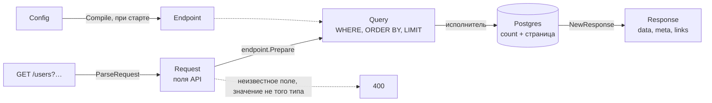

# go-paginate

[](https://github.com/svyatoslavratov/go-paginate/actions/workflows/ci.yml)
[](https://pkg.go.dev/github.com/svyatoslavratov/go-paginate)
[](https://scorecard.dev/viewer/?uri=github.com/svyatoslavratov/go-paginate)
[](LICENSE)

[English version](README.md)

Пагинация, сортировка, поиск и фильтры для списковых ручек на Go по мотивам
[nestjs-paginate](https://github.com/ppetzold/nestjs-paginate). Язык запросов тот же: `page`,
`limit`, `sortBy`, `search`, `searchBy`, `filter.<поле>=$оператор:значение`, `filter=<выражение>` и
`cursor`. Ответ — `{data, meta}`, по выбору с `meta` и `links` как у nestjs-paginate. Фронтенд,
написанный под nestjs-paginate, работает с бэкендом на Go без изменений, с оговорками из
[сравнения](docs/nestjs-compatibility.md) с nestjs-paginate 16.0.1.

**[Живое демо](https://svyatoslavratov.github.io/go-paginate/)**: все фильтры, сортировки, режимы
подсчёта и форматы ответа на настоящей таблице прямо в браузере (Go, скомпилированный в
WebAssembly, и Postgres в [PGlite](https://pglite.dev)). То же демо на chi, GORM и Postgres
запускается командой `docker compose up` в [examples/catalog](examples/catalog).

- **Поле — в одном месте.** Каждое поле API — один `Field`: его колонка, тип и что с ним можно
  делать клиенту. Или поля из тегов структуры: `paginate:"sort;search;filter:$in"`.
- **Проверка один раз, при старте.** `Compile` сообщает обо всех ошибках конфига до первого
  запроса; запрос делает только то, что ему нужно.
- **Типизированные значения.** Поля типов `Int`, `Time`, `UUID`, `Enum(...)` отклоняют неподходящее
  значение до выполнения запроса — ответом 400 с именем поля.
- **Номера страниц или курсоры.** Пагинация по смещению со стабильными страницами или keyset-
  пагинация, где Postgres начинает сканирование индекса прямо с курсора, как глубоко ни листай.
- **Подсчёт под размер таблицы.** Точный, оценка планировщика или никакого; при желании —
  параллельно со страницей.
- **Ошибки, с которыми клиент может работать.** `{"code": "invalid_value", "field": "price",
  "message": ...}`, а статус выбирает `HTTPStatus`.
- **Выражения фильтров.** `filter=(status=$in:paid,shipped OR total=$gte:1000) AND NOT comment=$null` —
  грамматика и ограничения как в nestjs-paginate 15+.
- **Два исполнителя, один SQL.** `gormx.Paginate` работает на GORM, `squirrelx.Paginate` — на
  squirrel и pgx; свой исполнитель — несколько строк. У ядра нет зависимостей.
- **Белые списки.** Клиенту доступны только поля и операторы из конфига. Каждое значение
  передаётся параметром запроса.

## Содержание

- [Установка](#установка)
- [Быстрый старт](#быстрый-старт)
- [Как проходит запрос](#как-проходит-запрос)
- [Параметры запроса](#параметры-запроса)
- [Фильтры](#фильтры)
- [Конфигурация](#конфигурация)
- [Страницы и подсчёт](#страницы-и-подсчёт)
- [Ошибки](#ошибки)
- [nestjs-paginate](#nestjs-paginate)
- [Производительность](#производительность)
- [Статус и версии](#статус-и-версии)
- [FAQ](#faq)
- [Документация](#документация)
- [Участие в разработке](#участие-в-разработке)
- [Лицензия](#лицензия)

## Установка

```sh
go get github.com/svyatoslavratov/go-paginate
```

```go
import (
	"github.com/svyatoslavratov/go-paginate"
	"github.com/svyatoslavratov/go-paginate/gormx"     // GORM
	"github.com/svyatoslavratov/go-paginate/squirrelx" // squirrel + pgx
	"github.com/svyatoslavratov/go-paginate/fasthttpx" // fasthttp
)
```

| Пакет | Импорт | Назначение |
|---|---|---|
| `paginate` | `github.com/svyatoslavratov/go-paginate` | Конфиги и теги, разбор (net/http), проверка и SQL, ответы. Без зависимостей. |
| `gormx` | `github.com/svyatoslavratov/go-paginate/gormx` | Исполнение на GORM, конфиги из моделей GORM. |
| `squirrelx` | `github.com/svyatoslavratov/go-paginate/squirrelx` | Исполнение на select из squirrel и pgx. |
| `fasthttpx` | `github.com/svyatoslavratov/go-paginate/fasthttpx` | Разбор запросов fasthttp. |

Нужны Go 1.26 или новее и Postgres (SQL использует `ILIKE`, `@>` и `CAST`). Свой исполнитель
(database/sql, sqlx, bun) выполняет подготовленный запрос так же, как встроенные.

## Быстрый старт

```go
// usersEndpoint is compiled once: a broken config stops the service at startup.
var usersEndpoint = paginate.MustCompile(paginate.Config{
	Fields: []paginate.Field{
		{Name: "id", Column: "users.id", Type: paginate.Int},
		{Name: "createdAt", Column: "users.created_at", Type: paginate.Time, Sortable: true,
			Filter: []paginate.Operator{paginate.OpBtw}},
		{Name: "name", Column: "users.name", Sortable: true, Searchable: true},
		{Name: "email", Column: "users.email", Searchable: true},
		{Name: "status", Column: "users.status", Type: paginate.Enum("active", "invited", "blocked"),
			Filter: []paginate.Operator{paginate.OpIn}}, // $eq is always allowed
	},
	DefaultSort: []paginate.Sort{{Field: "createdAt", Order: paginate.Desc}},
	TieBreak:    "users.id",
})

func (h *Handler) ListUsers(w http.ResponseWriter, r *http.Request) {
	req, err := paginate.ParseRequest(r)
	if err != nil {
		writeError(w, err)
		return
	}
	page, err := gormx.Paginate[User](r.Context(), *req, usersEndpoint, h.db.Model(&User{}))
	if err != nil {
		writeError(w, err)
		return
	}
	writeJSON(w, http.StatusOK, page)
}

// writeError answers a client's mistake with a 400 and {code, field, message}, anything else with
// a bare 500.
func writeError(w http.ResponseWriter, err error) {
	if status := paginate.HTTPStatus(err); status == http.StatusBadRequest {
		writeJSON(w, status, err)
		return
	}
	writeJSON(w, http.StatusInternalServerError, map[string]string{"message": "internal error"})
}
```

```http
GET /users?page=2&limit=10&sortBy=name:asc&search=ann&filter.status=$in:active,invited&filter.createdAt=$btw:2024-01-01,2024-12-31
```

```json
{
  "data": [{ "id": 11, "name": "Ann", "email": "ann@example.com", "status": "active" }],
  "meta": {
    "itemsPerPage": 10,
    "totalItems": 11,
    "totalPages": 2,
    "currentPage": 2,
    "hasNextPage": false,
    "hasPreviousPage": true,
    "sortBy": [["name", "ASC"]],
    "search": "ann",
    "searchBy": [],
    "filter": { "createdAt": ["$btw:2024-01-01,2024-12-31"], "status": ["$in:active,invited"] },
    "paginationMode": "default"
  }
}
```

С `Format: paginate.FormatNestJS` тот же запрос отвечает как nestjs-paginate:

```json
{
  "data": [{ "id": 11, "name": "Ann", "email": "ann@example.com", "status": "active" }],
  "meta": {
    "itemsPerPage": 10,
    "totalItems": 11,
    "currentPage": 2,
    "totalPages": 2,
    "sortBy": [["name", "ASC"]],
    "search": "ann",
    "searchBy": ["name", "email"],
    "filter": { "createdAt": "$btw:2024-01-01,2024-12-31", "status": "$in:active,invited" }
  },
  "links": {
    "first": "/users?page=1&limit=10&sortBy=name:ASC&search=ann&filter.createdAt=$btw:2024-01-01,2024-12-31&filter.status=$in:active,invited",
    "previous": "/users?page=1&limit=10&sortBy=name:ASC&search=ann&filter.createdAt=$btw:2024-01-01,2024-12-31&filter.status=$in:active,invited",
    "current": "/users?page=2&limit=10&sortBy=name:ASC&search=ann&filter.createdAt=$btw:2024-01-01,2024-12-31&filter.status=$in:active,invited"
  }
}
```

А `filter.status=$in:active,deleted` — это 400 ещё до запроса в базу:

```json
{ "code": "invalid_value", "field": "status", "message": "invalid value \"deleted\" for status: must be one of active, invited, blocked" }
```

Поля можно описать и тегами — так же, как пишутся теги gorm:

```go
type User struct {
	ID        int64     `json:"id" paginate:"unique"`
	CreatedAt time.Time `json:"createdAt" paginate:"sort;filter:$btw"`
	Name      string    `json:"name" paginate:"sort;search"`
	Email     string    `json:"email" paginate:"search"`
	Status    string    `json:"status" paginate:"filter:$in;enum:active,invited,blocked"`
}

cfg, err := gormx.ConfigOf[User](db, "") // columns from the GORM schema; paginate.ConfigOf without GORM
```

`ConfigOf` возвращает обычный `Config`, поэтому теги и код смешиваются: `cfg.Field("status")` меняет
поле из тегов, `append(cfg.Fields, …)` добавляет колонки из JOIN. См.
[теги, указатели или код](docs/configuration.md#tags-pointers-or-code).

## Как проходит запрос



1. **Компиляция, один раз.** `paginate.Compile` (или `MustCompile`) проверяет `Config` и строит
   `Endpoint`, безопасный для параллельных запросов.
2. **Разбор.** `paginate.ParseRequest` (net/http), `fasthttpx.ParseRequest` или
   `paginate.ParseQuery` (любой роутер) читает строку запроса в `Request`. Ошибиться здесь может
   только кривой `sortBy`.
3. **Подготовка.** `endpoint.Prepare` сверяет запрос: поля и операторы — с белыми списками,
   значения — с типами, размеры — с лимитами. Он переводит поля API в колонки и собирает `Query`:
   SQL-условия с параметрами, `ORDER BY` с тайбрейком, страницу или курсор и способ подсчёта.
4. **Исполнение.** Исполнитель добавляет `Query` к вашему базовому запросу и выполняет подсчёт и
   выборку страницы. `gormx.Paginate` и `squirrelx.Paginate` делают шаги 3–5 одним вызовом; свой
   исполнитель занимает несколько строк ([пример](docs/use-cases/custom-executor.md)).
5. **Ответ.** `paginate.NewResponse` собирает `{data, meta}`, курсоры, а с `FormatNestJS` — ещё и
   ссылки.

Ошибка клиента на любом шаге оборачивает `ErrInvalidRequest`, включая значение, которое Postgres
отверг из-за типа, поэтому `paginate.HTTPStatus` подсказывает обработчику ответить 400.

## Параметры запроса

| Параметр | Пример | Смысл |
|---|---|---|
| `page` | `page=2` | Номер страницы, с 1. |
| `limit` | `limit=50` | Размер страницы, не больше `MaxLimit` (по умолчанию 100). `limit=0` — только количество, `limit=-1` — все строки (если разрешено). |
| `sortBy` | `sortBy=pinned:desc&sortBy=name:asc` | Повторяемый `поле:asc\|desc`; порядок параметров — приоритет ключей. |
| `search` | `search=ann` | Поиск подстроки без учёта регистра по полям для поиска. |
| `searchBy` | `searchBy=email` | Сужает поиск до части полей для поиска. |
| `filter.<поле>` | `filter.age=$gte:18` | Фильтр; повторите для нескольких условий на одно поле. |
| `filter` | `filter=age=$gte:18 OR status=$eq:vip` | Выражение: AND, OR, NOT и скобки над термами `поле=значение`. |
| `cursor` | `cursor=WyJuIiwi…` | Страница после (или до) строки при курсорной пагинации; берётся из ссылок или meta. |
| `paginationMode` | `paginationMode=count` | `default`, `count` (только количество) или `disabled` (все строки, если конфиг разрешает). |
| `withDeleted` | `withDeleted=true` | Вместе с мягко удалёнными строками (GORM, если конфиг разрешает). |

## Фильтры

Значение фильтра — `[$or:|$and:][$not:][$оператор:]значение`.

| Оператор | Пример | SQL |
|---|---|---|
| `$eq` (по умолчанию) | `filter.name=Milo` | `name = 'Milo'` |
| `$not` | `filter.name=$not:Milo` | `NOT (name = 'Milo')` |
| `$gt`, `$gte`, `$lt`, `$lte` | `filter.age=$gte:18` | `age >= 18` |
| `$in` | `filter.id=$in:1,2,3` | `id IN (1, 2, 3)` |
| `$btw` | `filter.age=$btw:4,6` | `age >= 4 AND age <= 6` |
| `$null` | `filter.seenAt=$null` | `seen_at IS NULL` |
| `$ilike` | `filter.title=$ilike:red` | `title ILIKE '%red%'` |
| `$sw` | `filter.title=$sw:red` | `title ILIKE 'red%'` |
| `$contains` | `filter.roles=$contains:admin,editor` | `roles @> '{admin,editor}'` (колонка-массив, где есть все значения) |

Несколько значений одного поля соединяются в цепочку в порядке запроса:
`filter.id=$gt:3&filter.id=$lt:5&filter.id=$or:$eq:7` — это `(id > 3 AND id < 5 OR id = 7)`. Поля
соединяются через AND, но поля, у которых первое значение начинается с `$or`, образуют одну
OR-группу. Для любой другой логики — выражение:

```http
GET /cats?filter=(color=$eq:black OR color=$eq:white) AND NOT name=$eq:Leche
```

`Type` поля проверяет каждое значение до запроса: `$gte:old` на поле `Int` — это 400 с именем
поля. Значения сравниваются с собственным типом колонки, поэтому `$eq:10.5` находит `10.50`. `%` и
`_` в `$ilike`, `$sw` и `search` — обычные символы. Подробности — в [docs/filters.md](docs/filters.md).

## Конфигурация

| Настройка | По умолчанию | Смысл |
|---|---|---|
| `Fields` | | Поля API: `Name`, `Column`, `Type`, `Sortable`, `Searchable`, `Filter` (разрешённые операторы; `nil` — без фильтра). |
| `DefaultSort` | первое сортируемое поле ASC | Сортировка запроса без `sortBy`, в именах API. |
| `TieBreak` | | Уникальная колонка в конце каждого `ORDER BY`; обязательна для курсорной пагинации. |
| `NullSort` | как в базе | `NullsFirst` или `NullsLast` для каждого ключа. |
| `Pagination` | `OffsetPagination` | Номера страниц или `CursorPagination`. |
| `Count`, `ExactCountBelow`, `ParallelCount` | `CountExact` | Как считать итоги: точно, оценкой или никак; см. [страницы и подсчёт](#страницы-и-подсчёт). |
| `MultiWordSearch` | `false` | Каждое слово поиска должно совпасть. |
| `Lenient` | `false` | Отбрасывать неизвестные поля и запрещённые операторы вместо 400, как nestjs-paginate. |
| `DefaultLimit`, `MaxLimit` | 20, 100 | Размер страницы. |
| `MaxSearchLength`, `MaxFilterConditions`, `MaxFilterValues`, `MaxFilterExpressionComplexity` | 256, 100, 1000, 100 | Лимиты запроса. |
| `AllowDisabledPagination` | `false` | Клиент может запросить все строки. |
| `AllowWithDeletedInQuery` | `false` | Клиент может запросить мягко удалённые строки. |
| `CompareAsText` | `false` | Сравнивать `$eq`/`$in` как текст — поведение до типизированного сравнения. |
| `Format` | свой | `FormatNestJS` — meta и ссылки как в nestjs-paginate. |
| `LinksBaseURL` | относительные ссылки | Префикс ссылок: origin или путь. |

Типы: `Text`, `Int`, `Number`, `Bool`, `Time`, `Date`, `UUID`, `Enum("a", "b")` и `ArrayOf(t)`.
Поля можно написать руками, прочитать из тегов `paginate` (`paginate.ConfigOf`, `gormx.ConfigOf`)
или собрать из указателей на поля модели и DTO (`gormx.NewBuilder`). См.
[docs/configuration.md](docs/configuration.md).

## Страницы и подсчёт

Номера страниц (`?page=3`) читают и пропускают строки до страницы; курсоры (`?cursor=`) начинают
сразу после последней строки, которую видел клиент, поэтому глубокая страница стоит как первая
(404 мс против 0,4 мс на глубине 855 000 строк), а появившиеся тем временем строки не сдвигают
страницы. Курсорная пагинация — это keyset-пагинация с теми же ссылками, что у nestjs-paginate:

```go
cfg.Pagination = paginate.CursorPagination // needs TieBreak; mark the sort fields NotNull where they are
```

```sql
WHERE ((users.created_at <= $1) AND ((users.created_at < $2) OR ((users.created_at = $3) AND (users.id > $4))))
ORDER BY users.created_at DESC, users.id ASC LIMIT 21
```

Итоги для номеров страниц стоят `COUNT(*)`. `Count` выбирает: `CountExact`, `CountEstimate` (оценка
планировщика через `EXPLAIN`, точный подсчёт ниже `ExactCountBelow`) или `CountNone` (признак
следующей страницы по одной лишней строке). `ParallelCount` считает параллельно со страницей. См.
[docs/pagination.md](docs/pagination.md).

## Ошибки

- `ErrInvalidRequest` — ошибка клиента. Это `*paginate.Error` с `Code` (`unknown_field`,
  `operator_not_allowed`, `invalid_value`, `invalid_cursor`, …), полем `Field`, к которому она
  относится, и `Message`, который можно показать; его JSON — тело ответа 400.
- `ErrInvalidConfig` — ошибка сервера; `Compile` сообщает о ней при старте.

`paginate.HTTPStatus(err)` — 400 или 500. См. [docs/errors.md](docs/errors.md).

## nestjs-paginate

В сравнении с nestjs-paginate **16.0.1**:

| | nestjs-paginate | go-paginate |
|---|---|---|
| Параметры запроса, операторы, `$not` | ✅ | ✅ |
| Выражения `filter=` | ✅ | ✅ |
| `$and`/`$or` внутри `filter.<поле>` | убраны в 15.0 | сохранены (правила 14.x) |
| `limit=0` — только количество, `limit=-1` — все строки | ✅ | ✅ (`limit=-1` по настройке) |
| `meta` с действующей сортировкой, `links` | ✅ | ✅ с `FormatNestJS` |
| Курсорная пагинация | числа и даты, вычисляется в SQL | keyset на любом типе, диапазон индекса при ключах `NotNull` |
| Типизированное сравнение, `$contains` как вхождение в массив | ✅ | ✅ |
| `multiWordSearch`, `withDeleted`, `ignoreSearchByInQueryParam` | ✅ | ✅ |
| Спецсимволы LIKE в поиске | шаблоны | обычные символы |
| Неизвестные поля | отбрасываются | 400, или отбрасываются с `Lenient` |
| `select`, связи, пути в JSONB | ✅ | ❌ |
| Типы значений, оценка количества, коды ошибок, тайбрейк, лимиты, `Compile` | ❌ | ✅ |

Полное [сравнение](docs/nestjs-compatibility.md) и [руководство по миграции](docs/migrating-from-nestjs.md),
где каждая возможность показана на TypeScript и на Go.

## Производительность

Библиотека тратит микросекунды, база — миллисекунды. На Apple M3 Pro разбор типичного запроса
(страница, два ключа сортировки, поиск и четыре фильтра) занимает около 1,3 мкс, а `Prepare` на
скомпилированном endpoint — около 3 мкс и 77 аллокаций. По сравнению с кодом, написанным вручную
под тот же запрос, с squirrel библиотека стоит столько же, с GORM — на несколько микросекунд
больше, а на Postgres разница теряется в шуме. Самый большой запрос, который пропускают лимиты по
умолчанию, обрабатывается за десятки микросекунд. Таблицы и инструкция по запуску — в
[docs/benchmarks.md](docs/benchmarks.md).

## Статус и версии

Первый релиз — v0.1.0. До v1.0.0 минорный релиз (v0.x.0) может менять API; каждое изменение описано
в [changelog](CHANGELOG.md) с инструкцией по обновлению, а патч-релизы (v0.x.y) только исправляют
ошибки. CI запускает [gorelease](https://pkg.go.dev/golang.org/x/exp/cmd/gorelease) на каждом
пул-реквесте, поэтому несовместимое изменение не пройдёт незамеченным.

| | Версии |
|---|---|
| Go | 1.26 и новее; CI проверяет два последних релиза |
| Postgres | 13–18, каждая версия в CI |
| GORM | gorm.io/gorm v1.31.2+, gorm.io/driver/postgres v1.6.3+ |
| squirrel, pgx | v1.5.4+, v5.11.0+ |
| fasthttp | v1.75.0+ |
| nestjs-paginate (совместимость) | 16.0.1 |

## FAQ

**Нужен ли GORM?** Нет. У корневого пакета нет зависимостей; `squirrelx` работает на squirrel и
pgx, а любой другой исполнитель может сам выполнить подготовленный запрос
([пример](docs/use-cases/custom-executor.md)).

**Безопасно ли так подставлять пользовательский ввод в SQL?** Колонки берутся только из конфига,
каждое значение передаётся параметром, `%` и `_` экранируются, размер запроса ограничен, а курсоры
проверяются, как любой другой ввод. Фазз-тесты в CI проверяют, что при любом вводе значения
попадают только в параметры. Подробнее — в разделе [безопасность](docs/security.md).

**MySQL, SQLite?** Пока нет: SQL написан под Postgres (`ILIKE`, `@>`, `NULLS LAST`, приведения
типов).

**Как отдавать DTO вместо моделей?** `paginate.Map` преобразует строки и сохраняет meta со
ссылками:

```go
page, err := gormx.Paginate[User](ctx, *req, usersEndpoint, db.Model(&User{}))
if err != nil {
	return err
}
writeJSON(w, http.StatusOK, paginate.Map(page, toUserDTO))
```

**Почему неизвестное поле — это 400?** Чтобы опечатка во фронтенде была видна сразу, а не
превращалась в неотфильтрованный список. Для поведения nestjs-paginate, которое такое поле
отбрасывает, включите `Lenient`.

**Номера страниц или курсоры?** Номера — для таблиц, по которым прыгают на нужную страницу; курсоры —
для лент, бесконечной прокрутки и выгрузок, где глубокие страницы должны оставаться быстрыми. См.
[страницы и подсчёт](docs/pagination.md).

**Как перенести ручку с nestjs-paginate?** В [руководстве по миграции](docs/migrating-from-nestjs.md)
каждая возможность показана на TypeScript и на Go.

## Документация

- [Конфигурация](docs/configuration.md), [параметры запроса](docs/query-syntax.md), [фильтры](docs/filters.md), [сортировка и тайбрейк](docs/sorting.md)
- [Страницы и подсчёт](docs/pagination.md), [ошибки](docs/errors.md), [безопасность](docs/security.md)
- [Сравнение с nestjs-paginate](docs/nestjs-compatibility.md), [миграция с nestjs-paginate](docs/migrating-from-nestjs.md)
- [Бенчмарки](docs/benchmarks.md), [демо-приложение](examples/catalog)
- Сценарии: [net/http + GORM](docs/use-cases/chi-gorm.md), [GORM: теги и билдер](docs/use-cases/gorm-builder.md),
  [squirrel + pgx и fasthttp](docs/use-cases/squirrel-pgx.md), [JOIN, алиасы, GROUP BY](docs/use-cases/joins-and-aliases.md),
  [выгрузки и подсчёт](docs/use-cases/exports-and-counts.md), [gRPC](docs/use-cases/grpc.md),
  [OpenAPI](docs/use-cases/openapi.md), [свой исполнитель](docs/use-cases/custom-executor.md), [тест конфига](docs/use-cases/testing.md)
- [Changelog](CHANGELOG.md)

## Участие в разработке

Issues и pull requests приветствуются, см. [CONTRIBUTING.md](CONTRIBUTING.md). Тесты: `make test`,
с одноразовым Postgres: `make test-pg`; бенчмарки и фазз-тесты: `make bench` и `make fuzz`, демо:
`make demo-up`. Об уязвимостях сообщайте закрыто, как описано в [SECURITY.md](SECURITY.md).

## Лицензия

[MIT](LICENSE).
